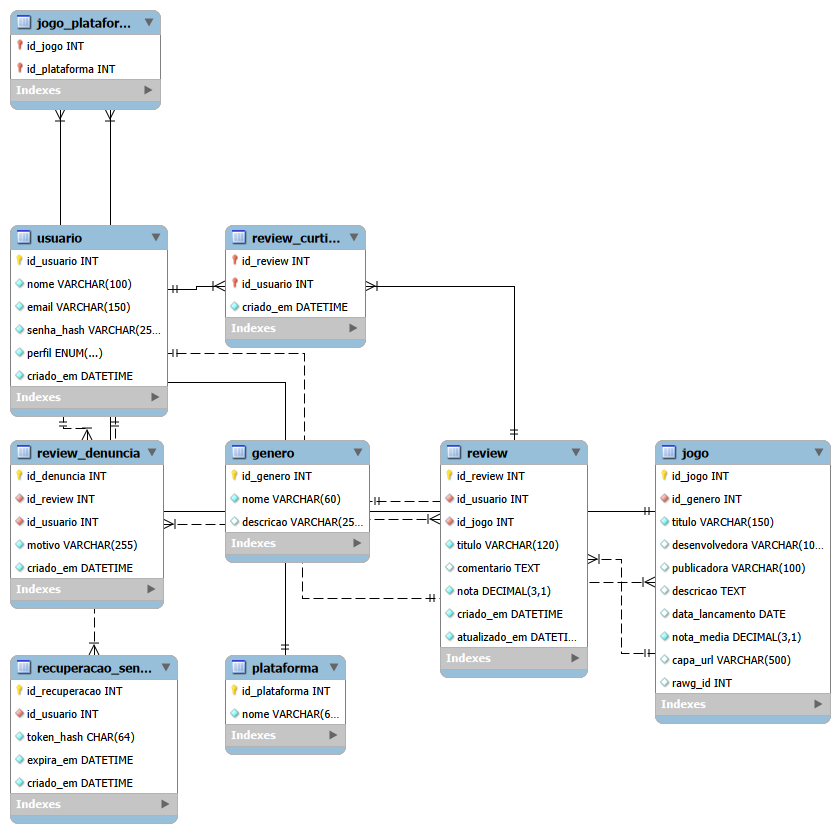

# Sistema de Reviews de Jogos

API em **Node.js (Express)** com banco **MySQL** para avaliação de jogos eletrônicos. Usuários cadastrados publicam reviews com nota de 0 a 10, e a aplicação calcula a nota média de cada jogo. Os dados dos jogos (título, capa, desenvolvedora etc.) podem ser importados da [RAWG API](https://rawg.io/apidocs).

O projeto roda inteiro em Docker: um comando sobe a API e o banco.

## Sumário

- Tecnologias
- Diagrama EER
- Resumo do schema.sql
- Entregas ( Semana | requisitos | link | Commit )
- Guia de execução
- Endpoints

## Tecnologias

| Categoria | Tecnologia | Uso no projeto |
|---|---|---|
| Linguagem | Node.js + JavaScript | API |
| Framework | Express 5 | Rotas HTTP |
| Banco de dados | MySQL 8 (driver `mysql2`) | Persistência relacional |
| API externa | RAWG API | Busca e importação de jogos |
| Contêineres | Docker + Docker Compose | Subir API e banco juntos |
| Autenticação | JWT (`jsonwebtoken`) + `bcryptjs` | Login por e-mail e senha, com perfis Comum e Administrador |
| E-mail | Nodemailer + Mailpit (Docker) | Recuperação de senha por e-mail |
| Testes de API (planejado) | Postman | Coleção com todos os endpoints |


## Diagrama EER 

### Imagem do diagrama :


### Regras de negócio detalhadas: [Regras_de_negócio](Sprints/Sprint-1.md?plain=1#L123)

### Resumo do schema.sql

| Tabela | Função | Principais restrições | Regras de negócio |
|---|---|---|---|
| `usuario` | Pessoas cadastradas (nome, e-mail, hash da senha, perfil) | `email` único; `perfil` é `COMUM` (padrão) ou `ADMIN` | 1 (e-mail único), 2 (senha só em hash), 9 (exclusão apaga as reviews do usuário) |
| `genero` | Categorias dos jogos | `nome` único | 7 (não pode ser excluído se tiver jogos) |
| `plataforma` | Plataformas em que os jogos existem | `nome` único | 11 (não pode ser excluída se tiver jogos) |
| `jogo` | Jogos avaliados, com `nota_media` e `rawg_id` da RAWG | `id_genero` obrigatório; `rawg_id` único; `nota_media` entre 0,0 e 10,0 | 6 (nota média recalculada), 8 (exclusão apaga as reviews do jogo), 10 (gênero obrigatório) |
| `jogo_plataforma` | Liga jogos e plataformas (N:N) | Chave primária composta `(id_jogo, id_plataforma)` | — |
| `review` | Avaliação de um usuário sobre um jogo | Uma review por `(id_usuario, id_jogo)`; `nota` entre 0,0 e 10,0; `atualizado_em` muda sozinho ao editar | 3 (só o autor edita ou exclui), 4 (uma review por usuário por jogo), 5 (nota válida), 6 (recálculo da nota média) |
| `review_curtida` | Marcações de "útil" em reviews | Uma curtida por usuário em cada review | — (prevista no escopo) |
| `review_denuncia` | Denúncias de reviews, com motivo | Uma denúncia por usuário em cada review | — (prevista no escopo) |

**Regras de integridade nas exclusões** (ver regras de negócio 7, 8 e 9)

- Excluir um gênero que tem jogos é bloqueado (`RESTRICT`).
- Excluir uma plataforma que tem jogos ligados a ela é bloqueado pela API (regra 11).
- Excluir um jogo ou um usuário apaga em cascata as reviews dele (`CASCADE`).
- Excluir uma review apaga suas curtidas e denúncias, e excluir um jogo apaga suas ligações com plataformas.


## Entregas

| Semana | requisitos | link | Commit |
|---|---|---|---|
| Semana 1 | definição do tema e escopo , modelagem inicial e criação e envio do repositório |[Sprint-1](Sprints/Sprint-1.md) | [Commit-modelagem]( https://github.com/gigi-zacaroni/Sistema_de_Reviews/commit/d09fcfee72594cbf6abf2183efe07afeaa80e208 ), [Commit-escopo](https://github.com/gigi-zacaroni/Sistema_de_Reviews/commit/235fc16ebcb130cf730af1cba52efcd3c196c3f4)  |
| Semana 2 | modelagem concluída , persistência e base da aplicação executável com Docker | ***como executar e testar o código***: [Sprint-2](Sprints/Sprint-2.md) |[Commit](https://github.com/gigi-zacaroni/Sistema_de_Reviews/commit/1e045e90b33d43e380b3316c1bc1281aa368d53e)|
| Semana 3 | autenticação com JWT (Usuário Comum e Administrador), controle de acesso, CRUDs e recuperação de senha por e-mail | ***como executar e testar o código***: [Sprint-3](Sprints/Sprint-3.md) | [Commit](https://github.com/gigi-zacaroni/Sistema_de_Reviews/commit/a06948157ba0def69ca62da2857d413574da23ed) |
| Semana 4 | CRUD das entidades centrais e regras de negócio em funcionamento | A entrega da semana 4 foi feita , de forma adiantada , na semana 3. Logo, os links são os mesmos da semana anterior | - |
| Semana 5 | conclusão das operações de CRUD aplicáveis ao escopo e integração funcional com a API externa (RAWG) | ***como executar e testar o código***: [Sprint-5](https://github.com/gigi-zacaroni/Sistema_de_Reviews/blob/main/Sprints/Sprint-5.md) | [Commit](https://github.com/gigi-zacaroni/Sistema_de_Reviews/commit/34a585182074516cbeda0a3d32d06e364543ba8f) |
| Semana 6 | revisão da solução, incluindo segurança, permissões, arquitetura e tratamento de erros; correção de falhas + **entrega final** | [Sprint-6](https://github.com/gigi-zacaroni/Sistema_de_Reviews/blob/main/Sprints/Sprint_6.md)| [Commit](https://github.com/gigi-zacaroni/Sistema_de_Reviews/commit/c72c25ba82797015ef99bd4b2fdf9d6e6f882a41) , [Commit](https://github.com/gigi-zacaroni/Sistema_de_Reviews/commit/a10a0ceeab3e4da5ab5690e6b111dfe03a449529) |

# Guia de execução — Sistema de Reviews

API em Node.js (Express 5) + MySQL 8, com e-mail de teste (Mailpit). Tudo roda em Docker com um único comando.

## 1. Pré-requisitos

| Ferramenta | Para quê |
|---|---|
| Docker Desktop (com Docker Compose) | Subir API, MySQL e Mailpit |
| Postman | Testar os endpoints |
| Chave da RAWG (opcional) | Buscar e importar jogos (veja a seção 3) |

## 2. Banco de dados (já configurado)

O `docker-compose.yml` cria as tabelas na primeira subida a partir do script `Back/Src/Schema/schema.sql`, por este volume do serviço `db`:

```yaml
      - ./Back/Src/Schema:/docker-entrypoint-initdb.d:ro
```

Confira que essa linha está assim. O script só roda quando o banco é criado pela primeira vez; para recriar do zero, veja "Recomeçar do zero" na seção 5.

## 3. Como conseguir a API key da RAWG

A chave é gratuita e só é necessária para os endpoints que usam a RAWG (`GET /rawg/jogos` e `POST /jogos/importar`). O resto da API funciona sem ela.

1. Acesse https://rawg.io/apidocs.
2. Clique em **Get API Key**.
3. Crie uma conta (e-mail e senha) ou entre com uma já existente e confirme o e-mail, se pedido.
4. Preencha o formulário de solicitação da chave: nome/descrição do projeto (por exemplo, "Sistema de Reviews de jogos, projeto acadêmico") e, se solicitado, a URL do projeto.
5. Copie a chave exibida na página (ela também fica disponível na área da sua conta, em https://rawg.io/apidocs).
6. Cole a chave em `Back/.env`:

   ```
   RAWG_API_KEY=sua_chave_aqui
   ```

7. Reinicie a API para ler o novo valor: `docker compose up --build`.

Observações:
- Não publique a chave no GitHub. O `.env` já está no `.gitignore` e no `.dockerignore`; envie ao repositório apenas o `.env.example`, com o valor de exemplo.
- O plano gratuito tem limite de requisições por mês e exige citar a RAWG como fonte dos dados; confira as condições atuais na própria página da RAWG.
- Se a API responder `503` ("Integração com a RAWG indisponível"), a chave está ausente ou ainda com o valor de exemplo.

### Sem chave ou com a RAWG fora do ar (modo falso)

Defina `RAWG_MOCK=1` no `Back/.env` e reinicie a API. Os endpoints `GET /rawg/jogos` e `POST /jogos/importar` passam a usar 6 jogos de exemplo (GTA V, Witcher 3, Portal 2, Zelda BotW, RDR2 e Portal), sem internet e sem `RAWG_API_KEY`. Para simular falhas: buscar `erro502` ou `erro503` em `/rawg/jogos`, ou importar um `rawg_id` inexistente (ex.: `999999`) para receber `404`. Volte para `RAWG_MOCK=0` quando a RAWG voltar. Código em `Back/Src/Apps/gateways/rawgGatewayFake.js`.

## 4. Configurar o `.env`

Na pasta `Back`, copie o exemplo:

```bash
cd Back
cp .env.example .env        # Windows (PowerShell): copy .env.example .env
```

Edite `Back/.env`:

- `RAWG_API_KEY`: sua chave ( para obter uma chave acesse "https://rawg.io/apidocs" ).
- `JWT_SECRET`: troque por um texto longo e aleatório.
- `ADMIN_EMAIL` / `ADMIN_SENHA`: administrador criado automaticamente na primeira subida (padrão `admin@reviews.com` / `Admin@12345`).

O restante (banco e e-mail) já é definido pelo `docker-compose.yml`.

## 5. Subir o projeto

Na raiz do projeto (onde está o `docker-compose.yml`):

```bash
docker compose up --build
```

| Serviço | Endereço |
|---|---|
| API | http://localhost:3000 |
| MySQL | `localhost:3308` (usuário `reviews_user`, senha `reviews_pass`, banco `sistema_reviews`) |
| Mailpit (caixa de e-mails de teste) | http://localhost:8025 |

Aguarde a mensagem `API rodando na porta 3000`. Para rodar em segundo plano use `docker compose up -d --build`, e para parar, `docker compose down`.

**Recomeçar do zero** (apaga o banco, recria as tabelas e o administrador):

```bash
docker compose down -v
docker compose up --build
```

## 6. Verificar se funcionou

Abra http://localhost:3000/health. Resposta esperada:

```json
{ "api": "ok", "banco": "ok" }
```

`503` com `"banco": "indisponivel"` indica que o MySQL ainda está iniciando (espere alguns segundos) ou que as tabelas não foram criadas (revise a seção 2 e recomece do zero).

## 7. Testar os endpoints no Postman

1. No Postman: **Import → File** e escolha `postman_collection.json`.
2. Confira as variáveis da coleção: `baseUrl` = `http://localhost:3000`, `adminEmail` e `adminSenha` (os mesmos do `.env`).
3. Rode as pastas em ordem pelo **Collection Runner**: Health → Auth → Gêneros → Plataformas → Jogos → Reviews → RAWG → Usuários → Limpeza. Tokens e ids ficam salvos nas variáveis automaticamente.
4. **Recuperação de senha:** rode "Esqueci minha senha", abra http://localhost:8025, copie o `token` do link do e-mail e cole nos requests "Redefinir senha".

Exemplo manual (login do admin):

```bash
curl -X POST http://localhost:3000/auth/login \
  -H "Content-Type: application/json" \
  -d '{"email":"admin@reviews.com","senha":"Admin@12345"}'
```

Use o `token` retornado no cabeçalho `Authorization: Bearer <token>` das rotas protegidas.


## 8. Importar jogos da RAWG

Pela API (como admin):

1. `GET /rawg/jogos?busca=zelda` para achar o `rawg_id` do jogo.
2. `POST /jogos/importar` com `{ "rawg_id": 3498 }`.

Por linha de comando (carga inicial, com a API no ar e a chave configurada), informando o gênero e a quantidade (padrão `action` e `10`):

```bash
docker compose exec api npm run importar -- action 10
```

### Endpoints

## Endpoints

**Legenda de acesso:** Público · Logado (qualquer usuário autenticado) · Próprio/Admin (o próprio usuário ou um Administrador) · Admin (somente Administrador)

Rotas protegidas exigem o cabeçalho `Authorization: Bearer <token>`.

### Saúde
| Método | Rota | Descrição | Acesso |
|---|---|---|---|
| GET | `/health` | Verifica se a API e o banco estão no ar | Público |

### Autenticação
| Método | Rota | Descrição | Acesso |
|---|---|---|---|
| POST | `/auth/cadastro` | Cadastra um usuário (perfil sempre `COMUM`) | Público |
| POST | `/auth/login` | Faz login e devolve o token JWT | Público |
| GET | `/auth/eu` | Devolve o usuário dono do token | Logado |
| POST | `/auth/esqueci-senha` | Envia por e-mail o link de recuperação de senha | Público |
| GET | `/auth/redefinir-senha?token=...` | Página aberta pelo link do e-mail | Público |
| POST | `/auth/redefinir-senha` | Troca a senha usando o token do e-mail | Público |

### Usuários
| Método | Rota | Descrição | Acesso |
|---|---|---|---|
| GET | `/usuarios` | Lista os usuários | Admin |
| GET | `/usuarios/:id` | Obtém um usuário | Próprio/Admin |
| PUT | `/usuarios/:id` | Atualiza os dados de um usuário | Próprio/Admin |
| PATCH | `/usuarios/:id/perfil` | Altera o perfil (`COMUM` ou `ADMIN`) | Admin |
| DELETE | `/usuarios/:id` | Exclui um usuário | Próprio/Admin |

### Gêneros
| Método | Rota | Descrição | Acesso |
|---|---|---|---|
| GET | `/generos` | Lista os gêneros | Público |
| GET | `/generos/:id` | Obtém um gênero | Público |
| POST | `/generos` | Cria um gênero | Admin |
| PUT | `/generos/:id` | Atualiza um gênero | Admin |
| DELETE | `/generos/:id` | Exclui um gênero (409 se houver jogos associados) | Admin |

### Plataformas
| Método | Rota | Descrição | Acesso |
|---|---|---|---|
| GET | `/plataformas` | Lista as plataformas | Público |
| GET | `/plataformas/:id` | Obtém uma plataforma | Público |
| POST | `/plataformas` | Cria uma plataforma | Admin |
| PUT | `/plataformas/:id` | Atualiza uma plataforma | Admin |
| DELETE | `/plataformas/:id` | Exclui uma plataforma (409 se houver jogos ligados) | Admin |

### Jogos
| Método | Rota | Descrição | Acesso |
|---|---|---|---|
| GET | `/jogos` | Lista jogos. Filtros: `busca`, `id_genero`, `id_plataforma`, `limite`, `deslocamento` | Público |
| GET | `/jogos/:id` | Obtém um jogo com suas plataformas | Público |
| POST | `/jogos` | Cadastra um jogo manualmente | Admin |
| POST | `/jogos/importar` | Importa um jogo da RAWG (`{ "rawg_id": 3498 }`) | Admin |
| PUT | `/jogos/:id` | Atualiza um jogo | Admin |
| DELETE | `/jogos/:id` | Exclui um jogo (e suas reviews) | Admin |

### Reviews
| Método | Rota | Descrição | Acesso |
|---|---|---|---|
| GET | `/reviews` | Lista reviews. Filtros: `id_jogo`, `id_usuario`, `limite`, `deslocamento` | Público |
| GET | `/reviews/:id` | Obtém uma review | Público |
| POST | `/reviews` | Cria uma review (nota de 0 a 10) | Logado |
| PUT | `/reviews/:id` | Edita a review (somente o autor) | Logado |
| DELETE | `/reviews/:id` | Exclui a review (autor ou Admin) | Logado |
| POST | `/reviews/:id/curtida` | Curte uma review | Logado |
| DELETE | `/reviews/:id/curtida` | Remove a própria curtida (`204`) | Logado |
| POST | `/reviews/:id/denuncia` | Denuncia uma review (`{ "motivo": "..." }`) | Logado |
| GET | `/reviews/denuncias` | Lista as denúncias | Admin |
| DELETE | `/reviews/denuncias/:id` | Descarta uma denúncia | Admin |

### RAWG
| Método | Rota | Descrição | Acesso |
|---|---|---|---|
| GET | `/rawg/jogos?busca=zelda` | Busca até 10 jogos na RAWG (ou no mock, com `RAWG_MOCK=1`) | Admin |
