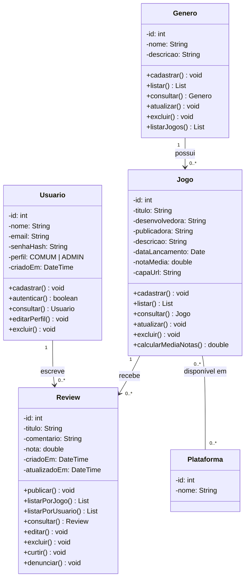
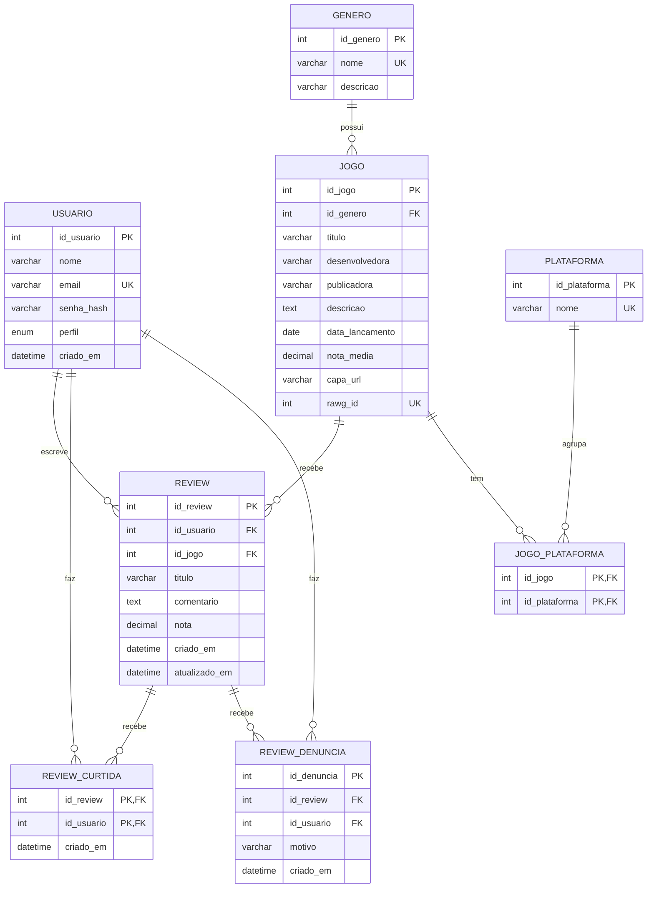

# Sistema de Reviews de Jogos

## Descrição do modelo

O Sistema de Reviews de Jogos gerencia avaliações de jogos feitas por usuários autenticados. Usuários cadastrados publicam reviews sobre jogos, que são organizados por gênero e plataforma.

A autenticação será feita por e-mail e senha, com emissão de token JWT. As senhas são armazenadas apenas como hash, e o controle de acesso é aplicado por perfil (Usuário Comum e Administrador) e por propriedade do recurso: somente o autor pode editar ou excluir a própria review. O banco garante e-mail único, nota entre 0,0 e 10,0, gênero obrigatório em todo jogo e uma única review por par usuário-jogo.

O modelo possui quatro entidades de negócio e quatro tabelas de apoio:

- **Usuario:** pessoa cadastrada na plataforma (nome, e-mail, senha em hash, perfil).
- **Genero:** categoria dos jogos (nome, descrição).
- **Jogo:** título avaliado (título, desenvolvedora, publicadora, descrição, data de lançamento, nota média, capa, id na RAWG).
- **Review:** avaliação de um usuário sobre um jogo (título, comentário, nota, datas de criação e atualização). Não é uma tabela de ligação: tem atributos e regras próprias.
- **Plataforma** e **jogo_plataforma:** plataformas em que o jogo está disponível (relação N:N), usadas nos filtros de busca.
- **review_curtida** e **review_denuncia:** interações com reviews (marcar como útil e denunciar), previstas no escopo.

### Relacionamentos

- Um usuário escreve várias reviews (1:N).
- Um jogo recebe várias reviews (1:N).
- Um gênero possui vários jogos (1:N).
- Um jogo está em várias plataformas e uma plataforma tem vários jogos (N:N, via `jogo_plataforma`).
- Um usuário pode curtir e denunciar várias reviews (N:N, via `review_curtida` e `review_denuncia`).

## Diagrama de classes

## Modelo do banco de dados

O script de criação está em [`Banco/schema.sql`](Banco/schema.sql). O banco é criado vazio: os jogos, gêneros e plataformas entram pela importação da RAWG

## CRUD por entidade

Todas as operações de CRUD fazem sentido no domínio e estão previstas no modelo. Nenhuma foi omitida; algumas têm restrições, descritas nas regras de negócio.

| Entidade | Create | Read | Update | Delete |
|---|---|---|---|---|
| Usuario | `cadastrar` | `consultar`, `autenticar` | `editarPerfil` | `excluir` |
| Genero | `cadastrar` | `listar`, `consultar`, `listarJogos` | `atualizar` | `excluir` |
| Jogo | `cadastrar` | `listar`, `consultar` | `atualizar` | `excluir` |
| Review | `publicar` | `listarPorJogo`, `listarPorUsuario`, `consultar` | `editar` | `excluir` |

## Regras de negócio

| # | Regra | Onde é garantida |
|---|---|---|
| 1 | **E-mail único:** não podem existir dois usuários com o mesmo e-mail. | Banco (`UNIQUE` em `usuario.email`) |
| 2 | **Senha:** nunca é armazenada em texto puro, somente o hash (`senha_hash`). | Aplicação |
| 3 | **Autoria da review:** somente o autor pode editar ou excluir a própria review. Ao editar, `atualizado_em` é atualizado. | Aplicação (autoria) e banco (`ON UPDATE CURRENT_TIMESTAMP`) |
| 4 | **Uma review por usuário por jogo:** para mudar a opinião, o usuário edita a review existente. | Banco (`UNIQUE (id_usuario, id_jogo)`) |
| 5 | **Nota válida:** entre 0,0 e 10,0. | Banco (`CHECK`) e aplicação |
| 6 | **Nota média:** `nota_media` do jogo é recalculada sempre que uma review for publicada, editada ou excluída. | Aplicação |
| 7 | **Excluir Genero:** bloqueado se houver jogos associados. | Banco (`ON DELETE RESTRICT`) |
| 8 | **Excluir Jogo:** as reviews do jogo são excluídas em cascata. | Banco (`ON DELETE CASCADE`) |
| 9 | **Excluir Usuario:** as reviews do usuário são excluídas em cascata e a `nota_media` dos jogos afetados é recalculada. | Banco (cascata) e aplicação (recálculo) |
| 10 | **Gênero obrigatório:** todo jogo deve ter um gênero válido. | Banco (`id_genero NOT NULL` + FK) |
