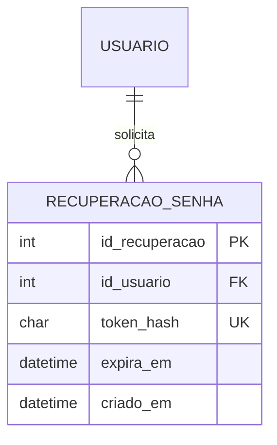

# Semana 3

Autenticação com JWT, controle de acesso por perfil, CRUDs e recuperação de senha por e-mail.

## O que foi desenvolvido

- **Autenticação por e-mail e senha** com token JWT (`POST /auth/login`). A senha é guardada só como hash (`bcryptjs`, regra 2).
- **Dois perfis:** Usuário Comum (`COMUM`) e Administrador (`ADMIN`).
- **Controle de acesso** em todos os recursos (matriz abaixo).
- **CRUDs** de usuário, gênero, jogo e review, com as regras de negócio da [Sprint-1](Sprint-1.md).
- **Interação com reviews:** curtir (marcar como útil) e denunciar, com listagem das denúncias para o Administrador.
- **Recuperação de senha por e-mail**, com link de uso único e validade de 30 minutos. É a única funcionalidade de envio de e-mail.

Serviços:

| Serviço | Descrição | Endereço |
|---|---|---|
| `db` | MySQL 8 | porta 3308 |
| `api` | API Node.js/Express | http://localhost:3000 |
| `mailpit` | Caixa de e-mails de teste: mostra os e-mails enviados pela API | http://localhost:8025 |

Na subida a API cria o **administrador inicial** com os valores de `ADMIN_EMAIL` e `ADMIN_SENHA` do `Back/.env` (padrão: `admin@reviews.com` / `Admin@12345`). 

## Autenticação

1. `POST /auth/cadastro` cria uma conta sempre com perfil `COMUM`. Não existe como se cadastrar como administrador: o primeiro nasce do `.env` e depois um administrador pode promover outros (`PATCH /usuarios/:id/perfil`).
2. `POST /auth/login` devolve `token`. Nas demais rotas protegidas, envie `Authorization: Bearer <token>`.
3. O token vale por 2 horas (`JWT_EXPIRES_IN`). A cada requisição a API confere no banco se o usuário ainda existe e qual é o perfil atual.
4. `401` significa "não está logado ou o token é inválido"; `403` significa "está logado, mas não tem permissão".

## Matriz de permissões

| Recurso | Operação | Público | Usuário Comum | Administrador |
|---|---|:-:|:-:|:-:|
| Conta | Cadastrar, login, recuperar senha | Sim | Sim | Sim |
| Usuário | Listar todos | Não | Não | Sim |
| Usuário | Consultar / editar nome e e-mail | Não | Só a própria | Qualquer |
| Usuário | Alterar perfil | Não | Não | Sim |
| Usuário | Excluir | Não | Só a própria conta | Qualquer (menos o único admin) |
| Gênero | Listar / consultar | Sim | Sim | Sim |
| Gênero | Cadastrar / editar / excluir | Não | Não | Sim |
| Jogo | Listar / consultar | Sim | Sim | Sim |
| Jogo | Cadastrar / editar / excluir | Não | Não | Sim |
| Review | Listar / consultar | Sim | Sim | Sim |
| Review | Publicar | Não | Sim | Sim |
| Review | Editar | Não | Só a própria | Só a própria |
| Review | Excluir | Não | Só a própria | Qualquer |
| Review | Curtir / remover a própria curtida | Não | Sim | Sim |
| Review | Denunciar | Não | Sim | Sim |
| Review | Ver as denúncias | Não | Não | Sim |

Por que a exclusão ficou assim, de acordo com as regras de negócio:

- **Review:** o autor edita e exclui a própria review. Usuários comuns não excluem reviews de outras pessoas. O Administrador pode excluir qualquer review (moderação, por exemplo de reviews denunciadas), mas não edita o texto de ninguém. Ao excluir, a nota média do jogo é recalculada.
- **Usuário:** a regra 9 trata da exclusão da conta; o dono pode excluir a própria e o administrador pode excluir qualquer uma. A API impede a exclusão ou o rebaixamento do único administrador, para o sistema nunca ficar sem um.
- **Gênero e jogo:** são operações administrativas (escopo: "exclusão de jogos por administradores"), restritas ao `ADMIN`. A regra 7 continua valendo: gênero com jogos não é excluído (`409`).
- A **nota média** (regra 6) é recalculada ao publicar, editar ou excluir uma review, e também ao excluir um usuário.

## Recuperação de senha

Fluxo:

1. `POST /auth/esqueci-senha` com o e-mail. A resposta é sempre a mesma, exista o e-mail ou não, para não revelar quem tem conta.
2. A API gera um token aleatório, grava só o **hash** dele na tabela `recuperacao_senha` (validade de 30 minutos) e envia o link por e-mail.
3. O link abre `GET /auth/redefinir-senha?token=...`, uma página simples servida pela própria API, onde a pessoa digita a nova senha.
4. A página chama `POST /auth/redefinir-senha`. Se o token é válido e não expirou, a senha é trocada e o token é descartado (uso único). Um novo pedido invalida o anterior.

No Docker os e-mails não saem para a internet: abra **http://localhost:8025** para ler o e-mail enviado. Para usar um SMTP de verdade (Gmail, por exemplo), apague `SMTP_HOST` e `SMTP_PORT` do serviço `api` no `docker-compose.yml` e preencha as variáveis `SMTP_*` e `MAIL_FROM` no `Back/.env`.

Nova tabela do banco:




## Como executar

```bash
cd Sistema_de_Reviews-main

# copie o arquivo de exemplo e preencha RAWG_API_KEY e JWT_SECRET
cp Back/.env.example Back/.env

docker compose up --build
```


## Como testar

Os testes usam o **Postman** (aplicativo para computador). A API precisa estar no ar (`docker compose up`) e o endereço http://localhost:3000/health deve responder `{"api":"ok","banco":"ok"}`.


#### 1. Login como administrador

| Campo | Valor |
|---|---|
| Método e endereço | `POST` `http://localhost:3000/auth/login` |
| Authorization | nenhuma |
| Body (raw, JSON) | `{"email":"admin@reviews.com","senha":"Admin@12345"}` |
| Esperado | **200**, com `token` e `"perfil": "ADMIN"` |

Copie o valor de `token` da resposta (só o texto, sem aspas). A partir daqui, ele é o **token do administrador**: cole-o na aba Authorization (Bearer Token) das requisições marcadas como "Admin". Para não colar toda vez, crie uma variável `tokenAdmin` na aba **Variables** da coleção e use `{{tokenAdmin}}` no campo Token. O token vale 2 horas; depois disso, faça o login de novo.

#### 2. Cadastrar um usuário comum e fazer login

| # | Método e endereço | Authorization | Body | Esperado |
|---|---|---|---|---|
| 2a | `POST` `/auth/cadastro` | nenhuma | `{"nome":"Ana","email":"ana@teste.com","senha":"senha12345"}` | **201**, `"perfil": "COMUM"` |
| 2b | `POST` `/auth/login` | nenhuma | `{"email":"ana@teste.com","senha":"senha12345"}` | **200**, com `token` |

Copie o `token` da 2b: é o **token da Ana** (variável `tokenAna`). Se a Ana já existir, o cadastro devolve **409**, e isso está certo.

#### 3. Verificar o controle de acesso

| # | Requisição | Authorization | Body | Esperado |
|---|---|---|---|---|
| 3a | `GET` `/usuarios` | nenhuma | nenhum | **401** (falta login) |
| 3b | `POST` `/generos` | token da **Ana** | `{"nome":"RPG"}` | **403** (usuário comum não pode) |
| 3c | `POST` `/generos` | token do **administrador** | `{"nome":"RPG","descricao":"Jogos de interpretação de papéis"}` | **201** (anote o `id_genero`) |

#### 4. Reviews, autoria e nota média

Você precisa de um jogo. Se o banco já tem jogos importados da RAWG (`docker compose exec api node src/importar_rawg.js action 5`), faça `GET /jogos` e use o `id_jogo` de um deles. Senão, cadastre um como administrador:

| Requisição | Authorization | Body | Esperado |
|---|---|---|---|
| `POST` `/jogos` | token do **administrador** | `{"id_genero":1,"titulo":"Meu Jogo Teste"}` (troque `1` pelo `id_genero` do passo 3c) | **201** (anote o `id_jogo`) |

Depois, nas requisições abaixo, troque `1` pelo `id_jogo` real:

| # | Requisição | Authorization | Body | Esperado |
|---|---|---|---|---|
| 4a | `POST` `/reviews` | token da **Ana** | `{"id_jogo":1,"titulo":"Muito bom","comentario":"Gostei bastante","nota":9}` | **201** |
| 4b | `POST` `/reviews` (o mesmo corpo de novo) | token da **Ana** | igual ao 4a | **409** (regra 4: uma review por usuário por jogo) |
| 4c | `POST` `/reviews` com nota 11 | token de **outro usuário** | `{"id_jogo":1,"titulo":"x","nota":11}` | **400** (regra 5: nota de 0 a 10) |
| 4d | `GET` `/jogos/1` | nenhuma | nenhum | **200**, com `nota_media` recalculada (regra 6) e `qtd_reviews` |


#### 5. Curtir, denunciar e moderar

Precisa de um **segundo usuário comum** (cadastre e faça login, como no passo 2, por exemplo `bia@teste.com`). Chame o token dele de `tokenBia`. Considere que a review da Ana tem `id_review` 1 (veja o valor real na resposta do 4a).

| # | Requisição | Authorization | Body | Esperado |
|---|---|---|---|---|
| 5a | `POST` `/reviews/1/curtida` | token do **administrador** | nenhum | **201**; repetir dá **409** |
| 5b | `POST` `/reviews/1/denuncia` | token da **Bia** | `{"motivo":"Conteúdo ofensivo"}` | **201**; repetir dá **409** |
| 5c | `DELETE` `/reviews/1` | token da **Bia** | nenhum | **403** (usuário comum não exclui review de outra pessoa) |
| 5d | `GET` `/reviews/denuncias` | token da **Ana** | nenhum | **403** |
| 5e | `GET` `/reviews/denuncias` | token do **administrador** | nenhum | **200**, lista a denúncia |
| 5f | `DELETE` `/reviews/1` | token do **administrador** | nenhum | **204** (sem conteúdo, é o normal) |

A autora, a Ana, também conseguiria excluir a própria review com o token dela. No 5f, a nota média do jogo é recalculada. Na coleção: 5. Reviews.

#### 6. Recuperação de senha

| # | Requisição | Authorization | Body | Esperado |
|---|---|---|---|---|
| 6a | `POST` `/auth/esqueci-senha` | nenhuma | `{"email":"ana@teste.com"}` | **200** (a mensagem é a mesma exista o e-mail ou não) |

1. Abra http://localhost:8025 (Mailpit) e o e-mail "Recuperação de senha".
2. Clique no link, digite a nova senha duas vezes e envie.
3. No Postman, faça `POST /auth/login` com a nova senha (**200**) e com a antiga (**401**).
4. Clicar no mesmo link de novo mostra "Link inválido ou expirado", porque o token é de uso único.


### Problemas comuns

| Sintoma | Causa provável | Solução |
|---|---|---|
| A API reinicia sozinha e o log diz `JWT_SECRET não definida` | `Back/.env` ausente | `cp Back/.env.example Back/.env` e suba de novo |
| `Table 'recuperacao_senha' doesn't exist` | Volume antigo do MySQL, criado antes desta versão | `docker compose down -v` e `docker compose up --build` |
| Não consigo entrar como administrador | O banco já existia com outro `ADMIN_EMAIL`/`ADMIN_SENHA` | Recrie o banco (`down -v`) ou promova uma conta com `PATCH /usuarios/:id/perfil` |
| O e-mail de recuperação não chega no Mailpit | A API não conseguiu enviar | Veja `docker compose logs api` (procure "Falha ao enviar e-mail") |
| Postman: `Could not get response` / `ECONNREFUSED` | A API não está no ar | Confira se o Docker está rodando e abra http://localhost:3000/health |
| **401** em tudo | Token ausente, expirado (vale 2 horas) ou colado com aspas ou com "Bearer" | Faça o login de novo e cole só o texto do `token` na aba Authorization (Bearer Token) |
| **400** "não é um JSON válido" | Vírgula faltando ou aspas curvas coladas de um editor | Use aspas retas `"` e confira se o Body está em **raw → JSON** |
| **200** em vez de **201**/**409** ao criar | O método está errado (`GET` ou `PUT` em vez de `POST`) | Confira a caixinha do método antes do **Send** |


