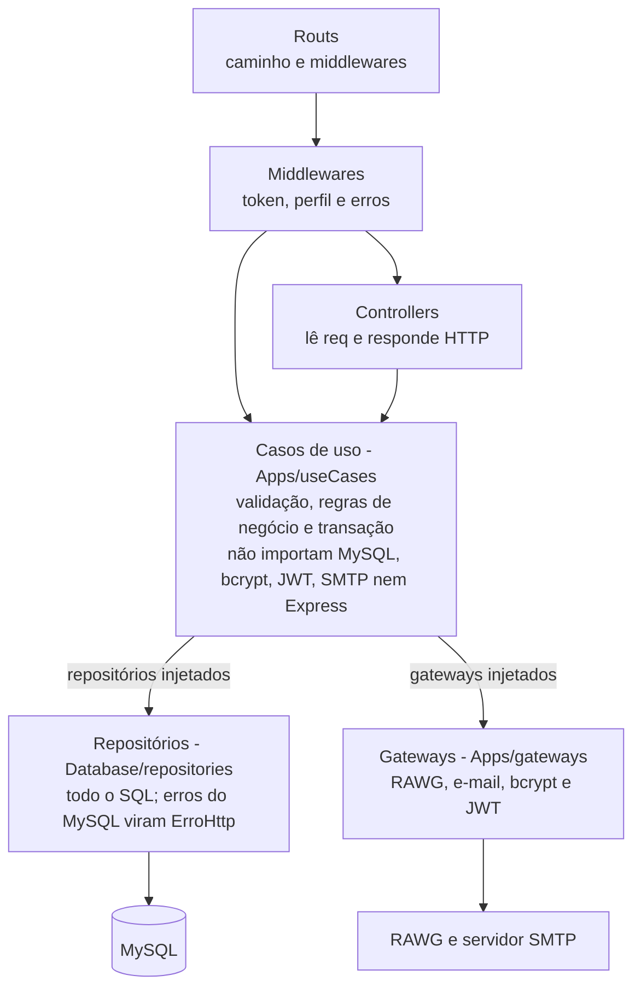

# Sprint 6

2026-11-05

## Objetivo

A Sprint 6 revisou a arquitetura da API de reviews de jogos para atender ao requisito 2.5 do desafio: separar regras de negócio, interface HTTP, persistência e integrações externas, com as dependências apontando para dentro. O trabalho teve duas etapas:

1. **Reorganização das pastas** na estrutura combinada (`Src/Apps`, `Configs`, `Database`, `Schema`, `Utils`, `Routs`).
2. **Clean Architecture de fato**: tirar o SQL e as regras de dentro dos controllers, criando casos de uso, repositórios e gateways. O desafio avisa que organizar pastas, isoladamente, não atende ao requisito.

## Resumo: antes e depois

O SQL saiu de 38 handlers de rota e foi para 6 repositórios; as regras foram para 7 arquivos de casos de uso.

| Aspecto | Antes | Depois |
| --- | --- | --- |
| Controllers | Rota, validação, regra e SQL no mesmo handler (`routes/*.js`) | Só HTTP: lê `req`, chama o caso de uso, responde com o status |
| Regras de negócio | Espalhadas nos handlers | `Src/Apps/useCases/`, um arquivo por recurso |
| SQL | Em rotas, middleware de autenticação, services e scripts | Só em `Src/Database/repositories/` |
| Transações | `comTransacao` entregava a conexão crua do MySQL | `unitOfWork.executar(repos => ...)` entrega repositórios já ligados à transação |
| Integrações | `services/` misturava SQL com chamadas externas | `Src/Apps/gateways/`: RAWG, e-mail, bcrypt e JWT |
| Erros do MySQL | Traduzidos no middleware global | Traduzidos na camada de persistência |
| Ligação entre camadas | Imports diretos de `db.js` em todo lugar | `Src/container.js` monta e injeta as dependências |
| Testes | Nenhum | 18 testes das regras, sem banco |

## Nova estrutura de pastas

A estrutura pedida foi mantida, com duas pastas novas dentro dela (`useCases` e `repositories`) e um arquivo de ligação (`container.js`).

```
Back/
├── server.js
├── public/redefinir-senha.html
├── tests/useCases.test.js
└── Src/
    ├── container.js
    ├── Routs/                 7 arquivos: caminho -> middlewares -> controller
    ├── Apps/
    │   ├── controllers/       7 arquivos, só HTTP
    │   ├── middlewares/       auth.js, erros.js
    │   ├── useCases/          7 arquivos, regras de negócio
    │   └── gateways/          rawg, email, senha (bcrypt), token (JWT)
    ├── Database/
    │   ├── repositories/      6 repositórios, todo o SQL
    │   ├── db.js, unitOfWork.js, traduzirErroBanco.js
    │   └── seedAdmin.js, importar_rawg.js
    ├── Configs/config.js
    ├── Schema/                schema.sql, DER.png, DER.mwb
    └── Utils/validacao.js
```

## Camadas e responsabilidades



As setas mostram quem chama quem. Os casos de uso nunca importam infraestrutura: `Src/container.js` cria os repositórios e gateways e os entrega a eles.

## Mudanças por módulo

- **Routs**: cada arquivo só liga método e caminho aos middlewares e ao controller. As 38 rotas e a ordem de registro (por exemplo `/reviews/denuncias` antes de `/reviews/:id`) foram preservadas.
- **Controllers** (auth, usuarios, generos, plataformas, jogos, reviews, rawg): ficaram com poucas linhas. Exemplo: `criarReview` chama `reviews.criar(req.usuario, req.body)` e responde `201`.
- **Casos de uso**: validação de entrada e regras de negócio, recebendo repositórios e gateways por parâmetro. Concentram, por exemplo, o recálculo da nota média (regra 6), a proteção do único administrador, "só o autor edita" e "autor ou administrador exclui" (regra 3), plataforma com jogos não pode ser excluída (regra 11) e a importação de jogos da RAWG.
- **Repositórios** (usuário, recuperação de senha, gênero, plataforma, jogo, review): todo o SQL. Nomes de coluna em `INSERT`/`UPDATE` dinâmicos passam por uma lista fixa permitida. Casos como curtida ou denúncia duplicada voltam como resultado simples (`false`/`null`), sem expor código do MySQL.
- **Gateways**: `rawgGateway` converte a resposta da RAWG para o formato do sistema e valida o tamanho dos campos; `emailGateway` envia o e-mail de recuperação; `senhaGateway` isola o bcrypt (inclui a comparação com hash falso que iguala o tempo do login); `tokenGateway` isola o JWT e a geração do token de recuperação.
- **Middlewares**: `autenticar` agora delega a verificação ao caso de uso `autenticarPorToken`, sem consultar o banco diretamente.
- **Scripts**: `seedAdmin.js` passou a usar o caso de uso `garantirAdminInicial` (a regra de criar o primeiro administrador ficou no caso de uso; o retry de espera do banco ficou no script). `importar_rawg.js` usa `jogos.importarPorGenero`, e `npm run importar` foi adicionado.
- **Config**: `config.js` agora também lê as variáveis do banco e a chave da RAWG, que antes eram lidas direto de `process.env` em outros arquivos.

## Tratamento de erros e transações

O middleware global de erros continua existindo, mas agora só conhece erros da aplicação, não do MySQL.

- Erros do MySQL (chave duplicada, chave estrangeira, `CHECK`, registro em uso) são traduzidos para `ErroHttp` em `Database/traduzirErroBanco.js`, aplicado a todo repositório por `comTraducaoDeErros`. Os status e as mensagens são os mesmos de antes (409, 400).
- `tratarErros` agora trata três casos: `ErroHttp`, JSON inválido no corpo (400) e qualquer outro erro como `500` com mensagem genérica, registrando o detalhe só no log.
- Transações usam `unitOfWork.executar`: abre a transação, entrega repositórios ligados a ela, confirma no fim e desfaz em caso de erro. Isso garante, por exemplo, que criar uma review e recalcular a nota média sejam gravados juntos, e que a importação da RAWG grave gênero, jogo e plataformas ou nada.

## Testes automatizados

Foram adicionados 18 testes em `tests/useCases.test.js`, usando o `node:test` nativo do Node, e todos passaram. Eles rodam os casos de uso com repositórios e gateways falsos, sem MySQL, Express nem internet. Para executar: `npm test`.

O que está coberto:

- Reviews: jogo inexistente (404), recálculo da nota média ao criar, nota fora de 0 a 10 (400), só o autor edita (403), autor ou administrador exclui (403 para outro comum), curtida duplicada (409).
- Usuários: recálculo da nota dos jogos ao excluir um usuário e proteção do único administrador.
- Autenticação: login com e-mail inexistente e senha errada dão a mesma resposta 401; recuperação sem e-mail cadastrado não envia nada; o banco recebe só o hash do token; token inválido não altera a senha; redefinição válida troca a senha e descarta os tokens.
- Jogos e plataformas: importação da RAWG duplicada (409), gravação de gênero, jogo e plataformas, plataforma inexistente (400) e plataforma com jogos ligados não é excluída (409).

Também foi feita uma checagem estática: 80 imports relativos válidos, nenhum caso de uso importa MySQL, bcrypt, JWT ou SMTP, e não há SQL fora de `Database/`.
